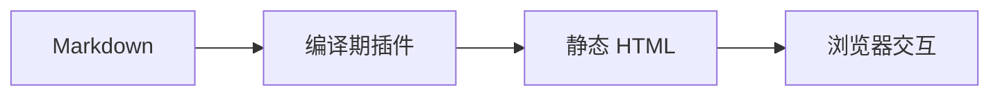

# Hello World

## 前言

- 还是照常先来一次`hello world`,庆祝这个博客完工(或许以后会做一些小组件之类的)，这个博客，我开发了四个星期左右，2026-09-06一直做到2026-10-04，挺长时间，也学了不少
- vue的特性用的不多，`{{插值}}`,`v-if`,`v-for`,`v-bind`用了一些，其他的不怎么用，作为新手，还是偏向于写ts(js)，一开始用js开发，但是代码类型不清，也没配置代码规范工具，写起来快，但是可读性一般，用ts后，有一套配套代码工具，而且初始化vue项目都一键配置好了，挺方便
- 也用AI辅助开发了，总共8500行左右的代码，其中15%左右是AI写的，主要集中在CSS的颜色样式和媒体查询，这两个我写的真不如它，反正只是调颜色和大小，让它做不影响什么，还有一些功能的快速开发也是它做的，代码我都读一遍，学会了之后，再照着写一遍，挺有收获

- 功能介绍:
  1. md->html:依赖于markdown-it
  2. ssg:依赖于vite-ssg以及vue-router
  3. 语法高亮:依赖于shiki
  4. mermaid:依赖于mermaid.js
  5. katex:依赖于md-it的katex插件
  6. 提示块:依赖于md-it的md-it-container插件
  7. 评论区:依赖于giscus
  8. 搜索:依赖于minisearch
  9. 音乐:依赖于howler
  10. 灯箱:依赖于medium-zoom

---

## 功能测试

### 标准 Markdown

除上述组件外，基础语法照常可用。

- 无序列表项一
- 无序列表项二

1. 有序列表项一
2. 有序列表项二

> 普通引用块仍然可用，不参与任何组件管线。

行内 `code`、**加粗**、_斜体_、[链接](/post/post-0) 都是标准行为。

```js
// 普通代码块走 shiki 编译期高亮，不进组件管线
const greeting = 'hello'
```

### 行内语法

按 [[Ctrl]] + [[C]] 复制，当前版本 {{v1.0}}，其中 ==编译期== 是关键。

语法是成对的定界符：`[[按键]]`、`{{徽章}}`、`==高亮==`。行内语法可出现在列表、标题等任何位置，但不作用于代码块内部。

---

### 提示块

围栏语言名即等级，四级共用同一套外壳；语言名之后可跟可选标题，省略时回落各等级的默认文案。

```tip 提示
标题可省略，省略时用各等级的默认文案。
```

```info 信息
省略标题时回落到：提示 / 信息 / 警告 / 错误。
```

```warn 警告
标题也可以自己写，会覆盖默认文案。
```

```error 错误
外壳结构由编译期直出，样式在 content.css。
```

块内正文走正常 markdown 渲染，**加粗**、`行内代码`、列表都照常生效。

---

### 目录树

语法是 Markdown 无序列表，缩进即层级，名称尾部带 `/` 表示目录，`|` 后接可选注释。

```filetree
- docs/ | 内容目录
  - post-0.md
  - post-1.md
  - post-2.md
- src/
  - .build/ | 编译期
    - plugins/
  - components/ | 运行期
- vite.config.ts | 构建配置
```

---

### 终端

语法是围栏代码块，以 `$ ` 开头的行按命令渲染，其余按输出渲染。

```terminal
$ npm run build
[vite-ssg] Rendering Pages... (10)
[vite-ssg] Build finished.
```

---

### 折叠块

语法是围栏代码块，第一行作标题，其余为折叠内容；内容整体转义、保留换行，不渲染 Markdown。

```details 点开看内容
折叠块里的 **Markdown 不会被渲染**，原样展示。
换行会保留，靠的是 CSS 的 pre-wrap。
```

---

### 流程

语法是每行「节点 | 可选说明」，节点之间自动画箭头。

```flow
读取 md | docs/*.md
编译期插件 | 拦截围栏直出 HTML
生成 SFC | .cache/*.vue
渲染页面 | vite-ssg 预渲染
```

---

### 时间线

语法是每行「时间 | 标题 | 描述（可省略）」，竖线由 CSS 绘制。

```timeline
2024-01 | 立项 | 确定技术选型
2025-06 | 原型 | 打通编译期直出
2026-10 | 移植 | 写作组件并入 blog
```

---

### 步骤

语法是每行「标题 | 描述（可省略）」，序号由编译期自动生成，不写进内容里。

```steps
写文档 | 在 docs/ 下新增 md
跑构建 | npm run build
看效果 | 打开对应的文章页
```

---

### 流程图

mermaid 在编译期只拦截并产出容器，图表由运行时按需渲染。



---

### 图表

echarts 块内必须是合法 JSON，编译期只校验并产出容器，非法时降级为纯文本展示源码。

```echarts
{
  "xAxis": { "type": "category", "data": ["编译期", "运行期"] },
  "yAxis": { "type": "value" },
  "series": [{ "type": "bar", "data": [100, 5] }]
}
```

---

### 卡片网格

语法是每行「标题 | 描述 | 链接（可省略）」，带链接时整卡可点击。

```cards
Linux服务器 | 第一次接触云服务器 | /post/post-1
无链接卡 | 只有标题和描述
```

---

### 链接卡

语法是每行「标题 | 描述 | 网址」，仅 http(s) 会被渲染成可点卡片，其他协议降级为静态卡。

```links
Vue | 渐进式框架 | https://vuejs.org
Vite | 下一代构建工具 | https://vite.dev
站内链接会降级 | 只放行 http(s) | /post/post-0
```

---

### 图集

语法是每行「图片地址 | 说明（可省略）」，复用正文图片的灯箱。

```gallery
/og-cover.png | 站点分享封面
/favicon.svg | 站点图标
```

---

### 数据卡与进度条

```stat
24 | 写作组件
100% | 编译期渲染
0 KB | 组件运行时代码
```

```progress
编译期渲染 | 85
运行时交互 | 40
超范围的数值会被收敛 | 120
```

---

### 属性列表

语法是每行「属性名 | 值」。

```attrs
articleDir | docs
outDir | dist
ogImage | /og-cover.png
```

---

### 选项卡

语法是用 `@tab 标签名` 分节，纯 CSS 切换，页内容整体转义、不渲染 Markdown。

```tabs
@tab 现象
站内切换文章时，正文先空白、闪一下才出现。
@tab 原因
正文来自按文章拆分的独立 chunk，到达前无内容可渲染。
@tab 做法
在视口内的站内链接上提前预取对应 chunk。
```

---

### 代码组

语法同样是 `@tab 标签名` 分节，区别在于标签名会被当作语言名送去 shiki 编译期高亮。

```code-group
@tab npm
npm run build
@tab pnpm
pnpm build
@tab ts
export default defineConfig({ title: 'blog' })
```

---

### 定义列表

```define
SSG | 静态站点生成器，构建期把内容直出为 HTML 文件
编译期 | 构建时执行，产物是静态文件
运行期 | 浏览器里执行的少量交互逻辑
```

---

### 问答

答案默认折叠，点击问题展开。

```qa
为什么把渲染放在编译期 | 首屏直出 HTML，SEO 友好，且客户端不需要模板渲染
写作组件会不会增大包体积 | 不会，它们只产出 HTML，样式集中在 content.css
```

---

### 对比栏

用 `@tab 栏标题` 分节，栏内每行一个条目。

```compare
@tab 编译期渲染
首屏直出 HTML
SEO 友好
改内容需要重新构建
@tab 运行时渲染
首屏依赖 JS
SEO 需额外处理
改内容无需构建
```

---

### 引用卡

语法是第一行为内容，之后「作者 | 出处」一行可省略。

```quote
任何可以用编译期解决的问题，都不应该留给运行时。
设计原则 | 项目手册
```

```quote
没有署名行也可以，只写内容即可。
```

---

### diff 代码块

语法是围栏代码块，语言名 `diff`，块内按 git 的标准 unified diff 写：`diff --git` / `index` / `---` / `+++` 是文件头，`@@ -l,s +l,s @@` 是块头，行首 `+` 为新增、`-` 为删除、一个空格开头为上下文。符号保留在行内，复制出来仍是可直接应用的 diff。

```diff
diff --git a/src/.build/plugins/diff.ts b/src/.build/plugins/diff.ts
index 4b1c9f2..8d3e5a7 100644
--- a/src/.build/plugins/diff.ts
+++ b/src/.build/plugins/diff.ts
@@ -22,7 +22,6 @@
-// 符号列与正文列分开，主题层可把符号列钉成窄列
-const DIFF_LINE = (cls: string, sign: string, text: string): string =>
-  `<span class="diff-line ${cls}"><span class="diff-sign">${sign}</span><span class="diff-text">${text}</span></span>`
+// 符号不拆列，整行连符号一起转义，复制出来仍是合法 diff
+const DIFF_LINE = (cls: string, text: string): string =>
+  `<span class="diff-line ${cls}">${text}</span>`

 // 块外壳：顶栏 + 行流
```

---
