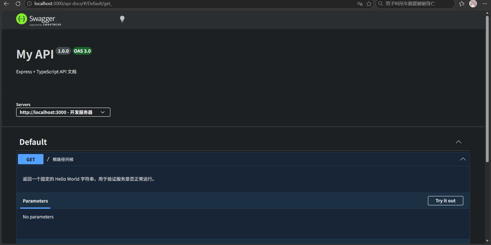

## 一、初始化项目

### 1. 初始化JavaScript项目

```terminal
$ npm init

package name: (server) spback
version: (1.0.0)
description: serverPanel backend
entry point: (index.js)
test command: test
git repository:
keywords: serverPanel
author: Cnkrru
license: (ISC) MIT
type: (commonjs) module
```

这里笔者只取了需要自己填写的配置

1. 包名
2. 版本号
3. 描述
4. 入口文件
5. 测试指令(这个后续增添编辑器有提示)
6. git仓库(留空)
7. 关键词
8. 作者
9. 开源协议
10. 类型(这里笔者选的是ESM,CommonJs现在大家不怎么用)

- 生成的配置文件

```json
{
  "name": "spback",
  "version": "1.0.0",
  "description": "serverPanel backend",
  "main": "index.js",
  "scripts": {
    "test": "test"
  },
  "keywords": ["serverPanel"],
  "author": "Cnkrru",
  "license": "MIT",
  "type": "module"
}
```

### 2. 安装typescript

```sh
npm install typescript
```

```tip
看个人情况，不喜欢写ts，不用也挺好
```

### 3. 初始化ts配置并简单修改一下

```sh
npx tsc --init
```

- 会在根目录生成tsconfig.json
- "rootDir": "./src"
- "outDir": "./dist"
  - 这两个注释解开,源码目录以及构建产物输出目录
- "lib": ["esnext"]
- "types": ["node"]
  - 这两个注释解开,限定环境为node，不导入DOM库

### 4. 安装express

```sh
npm install express                                 // 安装express
npm install --save-dev @types/express @types/node   // 安装express的类型
```

### 5. 修改`package.json`

```diff
- "main": "index.js"
+ "main": "dist/index.js"
```

```diff
- "test": "test"
+ "build": "tsc",
+ "start": "node dist/index.js",
+ "dev": "tsc --watch"
```

---

## 二、hello world

### 1. 在`src`文件夹下创建`index.ts`

```ts
import express from 'express'
// express请求体和返回体的数据类型
import type { Request, Response } from 'express'

// 创建expressAPP实例
const app = express()
// 实例在3000端口运行
const port = 3000
// get接口，helloworld
app.get('/', (req: Request, res: Response) => {
  res.send('Hello World!')
})

// 监听端口(这个必须放到最后)
app.listen(port, () => {
  console.log(`Server running at http://localhost:${port}`)
})
```

### 2. 运行项目

```sh
npm start // 在package.json里配置了start命令
```

---

## 三、热重载

### 1. 安装tsx

- 官网文档地址:[https://tsx.hirok.io/](https://tsx.hirok.io/)

```sh
npm install -D tsx
```

```info
- node的增强,直接将node指令的`node`替换成`tsx`即可
- 支持热重载(watch模式),自动重新运行更新的ts文件
- 支持直接运行ts文件,而不需要编译为js再运行
- 通过`npx`执行
```

- npx官方文档地址:[https://docs.npmjs.com/cli/v12/commands/npx](https://docs.npmjs.com/cli/v12/commands/npx)

### 2. 修改`package.json`

```diff
- "dev": "tsc --watch"
+ "dev": "tsx watch src/index.ts"
```

---

## 四、配置swaggerAPI文档

```tip
非必须，只是笔者自己挺喜欢这个文档

- 菜鸟教程swagger文档:[https://www.runoob.com/swagger/swagger-tutorial.html](https://www.runoob.com/swagger/swagger-tutorial.html)
```

### 1. 安装依赖

```tip
如果不想yaml注释写到代码内部，请看后续步骤，不要现在跟着操作
```

```sh
npm install swagger-jsdoc swagger-ui-express
npm install -D @types/swagger-jsdoc @types/swagger-ui-express
```

### 2. 创建配置文件

```ts
import swaggerJsdoc from 'swagger-jsdoc'

const options: swaggerJsdoc.Options = {
  definition: {
    openapi: '3.0.0',
    info: {
      title: 'My API',
      version: '1.0.0',
      description: 'Express + TypeScript API 文档',
    },
    servers: [
      {
        url: 'http://localhost:3000',
        description: '开发服务器',
      },
    ],
  },
  // 告诉 swagger-jsdoc 去哪些文件里找注释
  apis: ['./src/routes/*.ts', './src/index.ts'],
}

export const swaggerSpec = swaggerJsdoc(options)
```

### 3. 修改index.ts

- 导入swagger库，导入配置文件

```ts
// 导入swaggerAPI文档相关文件
import swaggerUi from 'swagger-ui-express'
import { swaggerSpec } from './doc.js'
```

- 挂载swagger中间件

```ts
app.use('/api-docs', swaggerUi.serve, swaggerUi.setup(swaggerSpec))
```

- 写swagger注释

```ts
/**
 * @swagger
 * /:
 *   get:
 *     summary: 根路径问候
 *     description: 返回一个固定的 Hello World 字符串，用于验证服务是否正常运行。
 *     tags: [Default]
 *     responses:
 *       200:
 *         description: 纯文本问候语
 *         content:
 *           text/plain:
 *             schema:
 *               type: string
 *               example: Hello World!
 */
app.get('/', (req: Request, res: Response) => {
  res.send('Hello World!')
})
```

- 访问地址

```terminal
http://localhost:3000/api-docs/
```

- 最终效果
  

### 4. 将swagger的文档与代码文件分离

- 由于swagger文档一般过长，与代码写一块儿的话，代码可读性太差了，所以这里改配置，将文档独立出来

#### 1. 更新依赖

```terminal
npm install yaml
npm uninstall swagger-jsdoc
```

#### 2. 将文档写到独立的yaml文件

1. 把原本写在代码里的文档去掉
2. 创建`docs/`文件夹(自己想放哪里都无所谓)
3. 写yaml文档

```yaml
/me:
  get:
    tags: [Auth]
    security:
      - bearerAuth: [] # 复用 components 里的 bearer 定义
    responses:
      '200':
        description: 当前用户信息
        content:
          application/json:
            schema:
              $ref: '#/components/schemas/User' # 复用公共 schema
```

#### 3. 修改原本的ts代码

- 删除doc.ts
- index.ts

```diff
@@ 导入区 @@
-import { fileURLToPath } from 'node:url';
-import { swaggerSpec } from './doc.js';
+import { readFileSync } from 'node:fs';
+import { parse } from 'yaml';

@@ webDir 之后新增 @@
+// OpenAPI 契约与源码分离，路径基于当前模块解析，不依赖启动目录
+const swaggerSpec = parse(readFileSync(new URL('../docs/openapi.yaml', import.meta.url), 'utf8'));

@@ Swagger 挂载 @@
-app.use('/api-docs', swaggerUi.serve, swaggerUi.setup(swaggerSpec));
+// Swagger UI：接口默认折叠、隐藏 Models、刷新后保留 token
+app.use(
+  '/api-docs',
+  swaggerUi.serve,
+  swaggerUi.setup(swaggerSpec, {
+    customSiteTitle: 'Express API 文档',
+    swaggerOptions: {
+      docExpansion: 'none',
+      defaultModelsExpandDepth: -1,
+      persistAuthorization: true,
+      filter: true,
+      tryItOutEnabled: true,
+      displayRequestDuration: true,
+    },
+  }),
+);
```

```info
这两步直接把原本doc.ts的配置去掉，在中间件挂载时配置swagger
```
