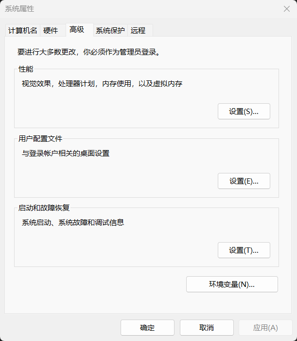
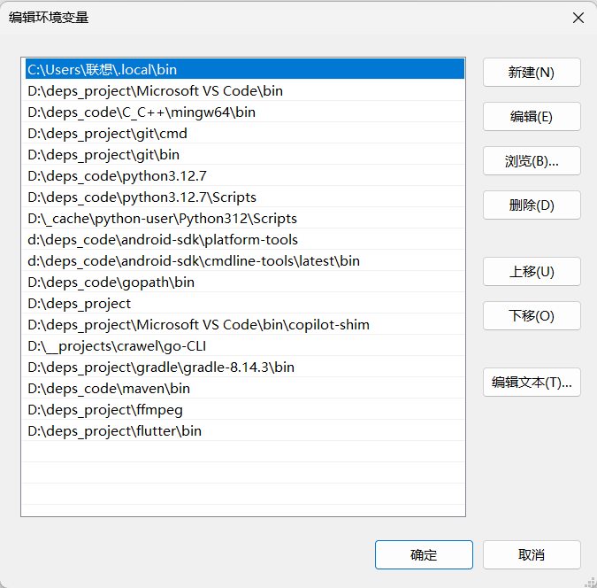
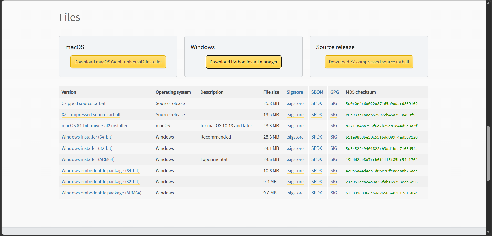

## 简介
Windows操作系统的开发环境配置问题主要与其shell解释器的配置方式(环境变量)有关
### Windows11
1. 这里介绍一下环境变量的位置
> 开始菜单 -> 设置 -> 系统 -> 系统信息 -> 高级系统设置 -> 环境变量
2. 点开后如下图:

3. 配置项
环境变量分为全局变量和用户变量，我们需要配置用户变量部分的`PATH`

这个图是我的环境变量的配置，可以看到有这几个配置:
- C/C++的minGW工具链
- git bash
- python解释器
- 安卓SDK
- java包管理器maven
- ffmpeg
- crawl(我用go自制的爬虫CLI)
这些基本都是CLI(命令行工具)
挂载到环境变量，我们可以就可以在任何地方打开Windows的shell解释器(cmd/powershell),然后调用他们这些工具注册的子命令
## 详细
### python
#### python介绍
#### python环境配置
> python官网:[https://www.python.org/](https://www.python.org/)
> python解释器下载页:[https://www.python.org/downloads/](https://www.python.org/downloads/)
- 挑一个自己想用的解释器版本下载就行
  - 这里我选的是12.7,版本不是越新越好,要考虑库成熟度,python12.7是两年前的，库挺成熟
- 下载页:

- 这里看自己的系统是什么，是什么架构的，大部分人的应该是Windows 64位
1. 