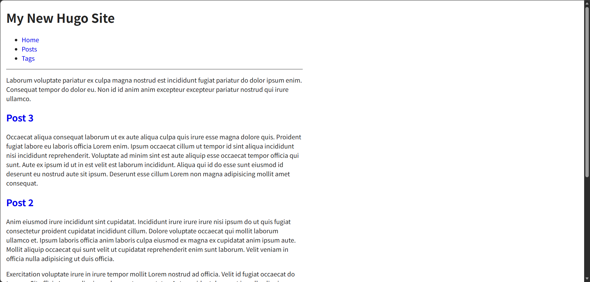

## 简介

- 站主最开始接触编程，是从`hexo`(一个js写的ssg)搭建blog开始，后来又接触了`hugo`(一个go写的ssg),由这两个，站主在学了py后，接触了前端，做的第一个网站也是这个博客，现在博客完工，正好将这个博客的改成hugo的主题

- 由于hugo主题开发站主只做一次，以后可能会给其他SSG开发主题，所以这里只写一篇md，站主尽量分段清晰些，方便读者学习hugo这个SSG的使用以及主题开发

- 本次开发，站主也会借助AI辅助开发，因为本身大部分代码已经写好，只需要把等效部分转移过去就行，所有代码，站主均会review，hello这个主题请放心使用

---

## 安装hugo

- [官网网址](https://github.com/gohugoio/hugo/releases/tag/v0.168.0)
- 下载好后，需要把这个exe的路径配置在环境变量里
  - CLI(命令行工具):hugo.exe是一个CLI(命令行工具)，Windows的设置里可以配置环境变量，环境变量是专门给Windows自带的shell解释器cmd/ps挂载子CLI的地方
  - shell解释器:shell是一种解释性语言，用于与系统交互，常用于服务器运维，这里Windows的cmd和ps并不是标准的shell解释器，对应代码也与标准的shell语言有所不同，但是挺像的

```tip
这个站主以后可能会出一个视频来教一下如何配置
```

---

## 初始化项目

### 1. 创建新项目

```sh
hugo new site <site_name>
cd <site_name>
```

### 2. 创建新主题

```sh
hugo new theme <theme_name>
```

### 3. 启用新主题

```sh
echo "theme = '<theme_name>'" >> hugo.toml
```

```tip
这里其实你自己去hugo.toml里手改一下对应配置就行，都一样
```

### 4. 启动预览服务

```sh
hugo server
```

- 效果图(默认主题)
  

### 5. 文件夹结构

```filetree
- archetypes/ | 原型模板
  - default.md
- assets/ | 待编译资源
- content/ | 站点内容
- data/ | 站点数据
- i18n/ | 多语言文案
- layouts/ | 站点模板
- static/ | 静态文件
- themes/ | 主题目录
  - hello/ | 要写的主题
    - archetypes/
      - default.md
    - assets/
      - css/
        - main.css
      - js/
        - main.js
    - content/
      - _index.md
      - posts/
        - _index.md
        - post-1.md
        - post-2.md
        - post-3/
          - bryce-canyon.jpg
          - index.md
    - data/
    - i18n/
    - layouts/
      - _partials/
        - head/
          - css.html
          - js.html
        - footer.html
        - head.html
        - header.html
        - menu.html
        - terms.html
      - baseof.html
      - home.html
      - page.html
      - section.html
      - taxonomy.html
      - term.html
    - static/
      - favicon.ico
    - hugo.toml
- hugo.toml | 站点配置
- public/ | 构建产物
  - categories/
    - index.html
    - index.xml
  - css/
    - main.css
  - js/
    - main.js
    - main.js.map
  - posts/
    - index.html
    - index.xml
    - post-1/
      - index.html
    - post-2/
      - index.html
    - post-3/
      - bryce-canyon.jpg
      - index.html
  - tags/
    - blue/
      - index.html
      - index.xml
    - green/
      - index.html
      - index.xml
    - red/
      - index.html
      - index.xml
    - index.html
    - index.xml
  - favicon.ico
  - index.html
  - index.xml
  - sitemap.xml
- .hugo_build.lock
```

---

## hugo与该blog项目的联系

```info
hugo-theme-hello本身基于站主这个blog，可能会做一些取舍，站主的blog是基于vue+一些第三方库

vue和hugo有一些相似之处，在下文会介绍

该blog的部分功能hugo内置，可以等效替换，在下文会介绍
```

### hugo自带功能(部分等效blog的功能)

1. 元数据解析,blog项目用的是`grey-matter`,将md的元数据与正文分别输出到json的一个子字典的不同字段
2. chroma高亮,blog项目用的是`shiki`,`chroma`是go生态的语法高亮库
3. rss,sitemap,blog项目用的是`vite-ssg-sitemap`
4. ssg,blog项目用的是`vite-ssg`
5. md->html,blog项目用的是`markdown-it`
6. 标题锚点,blog用的是`markdown-it`的插件
7. 分页,blog用的是笔者自己写的,把post.json的数据清洗,切分,然后每一个列表子页面对应一个切片

### 需要笔者自己迁移过来的功能

1. 音乐播放,原blog项目使用的是howler+自己写的UI
2.

### hugo与vue
